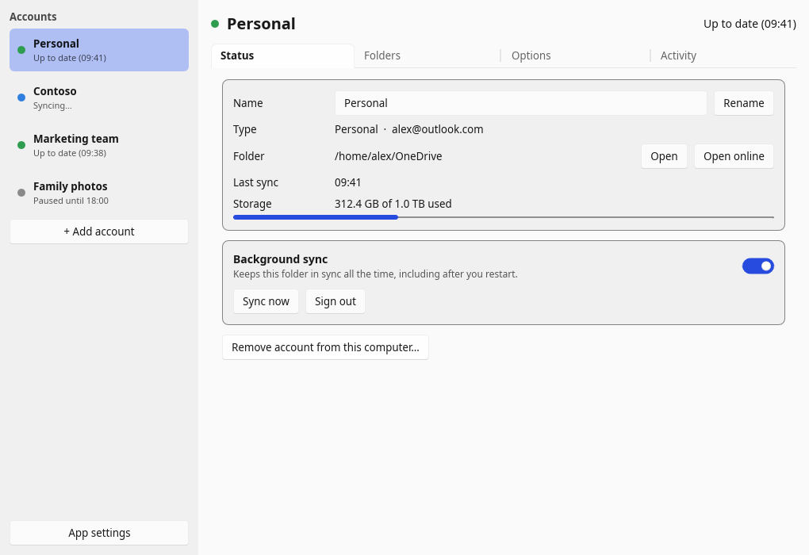
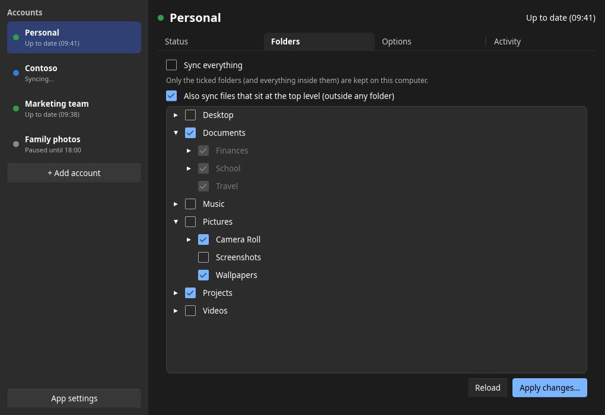
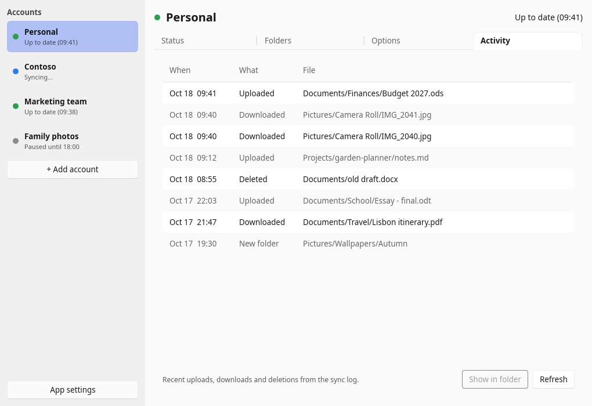

# A GUI that works with OneDrive on Linux (unofficial)

**Entirely unofficial — not endorsed by Microsoft at all.**

**Sync OneDrive and SharePoint on Linux, without the command line.**

A tray icon and settings window for the excellent [OneDrive Client for Linux](https://github.com/abraunegg/onedrive)
by abraunegg, which does the actual syncing and comes bundled. Download one file, sign in, pick your
folders, done. I am not a programmer, and I make ZERO, NONE, ABSOLUTELY NO SUGGESTION OR GUARANTEE this code
is safe, does what it says, or won't harm your PC in some way. It's vibe coded and you are welcome and encouraged to review the source code prior to installing. 
Again, to be clear, this app is not endorsed by Microsoft and I'm not affiliated with Microsoft in anyway. Since it's just a rust GUI for the existing onedrive sync client, syncing issues should go to the original app, which is linked above. 



<table>
  <tr>
    <td></td>
    <td></td>
  </tr>
</table>

## Features

- **Personal, work/school and SharePoint** — add as many accounts and document libraries as you like.
  For SharePoint, paste the site or library address from your browser, or pick from the sites your work
  account belongs to. Only sites that account can already open ever appear.
- **Sign in and out from the app** — your browser opens, you log in, and the app picks it up by itself.
- **Pick folders** — browse everything in your OneDrive, including folders that aren't on this computer yet,
  and tick the ones you want.
- **Safe changes** — anything that needs the sync engine to rebuild its view (a "full resync") first runs a
  dry run and shows exactly what would be downloaded, uploaded or deleted. Nothing changes until you press
  Apply. You can switch full resyncs off per account.
- **Tray icon** — live status for every account, recent files, *Sync now*, *Pause for 1 hour / 4 hours /
  until tomorrow*, and notifications when something needs attention.
- **Sync schedules** — e.g. only sync overnight between 23:00 and 07:00, plus a speed limit.
- **Activity view** — what was uploaded, downloaded or deleted, with *Show in folder*.
- **File manager integration (Dolphin)** — right-click a synced file for *Copy sharing link* or
  *View on the OneDrive website*.
- **Follows your desktop** — light and dark mode, your file manager, your browser.
- Works alongside an existing setup: accounts you already configured for the OneDrive client
  (including `onedrive-*.service` units) show up automatically.

## Install

Download from the [latest release](https://github.com/sweatshopking/Linux-Onedrive-GUI/releases/latest):

| Your system | Download | How to install |
|---|---|---|
| Ubuntu 22.04+, Linux Mint 21+, Debian 12+, Pop!_OS, Zorin | `linux-onedrive-gui_…_amd64.deb` | Double-click it, or `sudo apt install ./linux-onedrive-gui_*.deb` |
| Fedora 41+, openSUSE Tumbleweed / Leap 16 | `linux-onedrive-gui-….x86_64.rpm` | Double-click it, or `sudo dnf install ./linux-onedrive-gui-*.rpm` (openSUSE: `sudo zypper install ./linux-onedrive-gui-*.rpm`) |
| Anything else (Arch, Manjaro, older distros, no admin rights) | `Linux_OneDrive_GUI-…-x86_64.AppImage` | Right-click → Properties → allow executing, then double-click. In the app, *App settings → Add to my applications menu*. |

Those are for ordinary PCs. For ARM computers (Raspberry Pi 4/5, ARM laptops) pick the same kind of file
ending in `arm64` / `aarch64` instead.

Installing the .deb or .rpm fetches everything else it needs automatically, and the AppImage has it built
in, so there's nothing else to install.

Then open **A GUI that works with OneDrive on Linux (unofficial)** from your applications menu and follow the steps.

You don't need to install the `onedrive` package yourself — a tested copy is included.
(Ubuntu's own `onedrive` package is very old and not supported by its author; this app doesn't use it.)

### Requirements

- 64-bit Linux with systemd (almost every desktop distribution)
- A system tray for the tray icon: built into KDE Plasma, Cinnamon, XFCE, MATE and Budgie.
  On GNOME, install the *AppIndicator and KStatusNotifierItem Support* extension (Ubuntu has it already).

## How it works

Each account is a configuration folder for the OneDrive client (`~/.config/onedrive`, `~/.config/onedrive-work`, …)
and a systemd user service that keeps it syncing in the background — even after a restart and when the app
is closed. The app writes the client's normal config files, so you can switch to the command line at any
time and everything still works.

- Status comes from the service's log; controls go through `systemctl --user`.
- Browsing online folders, finding SharePoint libraries, storage use and sharing links use Microsoft Graph
  with the client's saved sign-in (read-only; the client's own sign-in file is never modified).
- Settings that are the app's own (names, schedules, pauses) live in `~/.config/linux-onedrive-gui/settings.json`.

## Uninstalling

Remove each account in the app first if you want its background service gone (your files are kept), then
uninstall the package — or delete the AppImage.

## Building from source

You need Rust (via [rustup](https://rustup.rs)) and the development packages for fontconfig, freetype,
xkbcommon and wayland. Then:

```sh
cargo build --release
./target/release/linux-onedrive-gui
```

During development it uses the `onedrive` client from your `PATH`.

To build the release packages exactly like the GitHub workflow does (needs podman or docker):

```sh
packaging/build-in-containers.sh        # .deb + AppImage on Ubuntu 22.04, .rpm on Fedora 41
```

### Tests

```sh
cargo test
```

The window can also be driven by a script for end-to-end testing — see `src/testdrive.rs`
(build with `--features test-driver`).

## License and credits

GPL-3.0-or-later — see [LICENSE](LICENSE).

- Syncing is done by the [OneDrive Client for Linux](https://github.com/abraunegg/onedrive) by abraunegg,
  GPL-3.0, bundled unmodified. See [packaging/THIRD-PARTY.md](packaging/THIRD-PARTY.md).
- The interface uses [Slint](https://slint.dev) (under its GPL-3.0 license) and
  [ksni](https://github.com/iovxw/ksni) for the tray icon.

This project is not made by or affiliated with Microsoft. OneDrive and SharePoint are trademarks of Microsoft.
