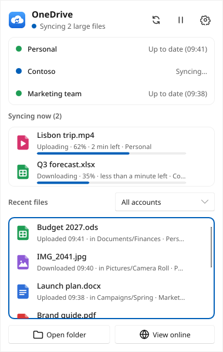
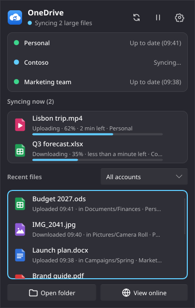
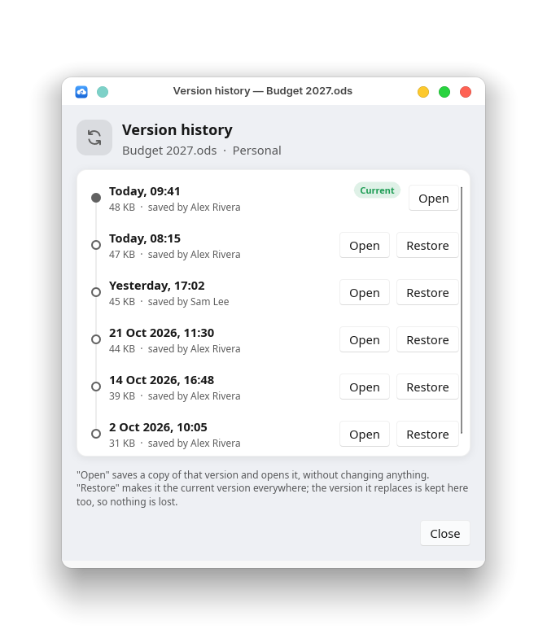
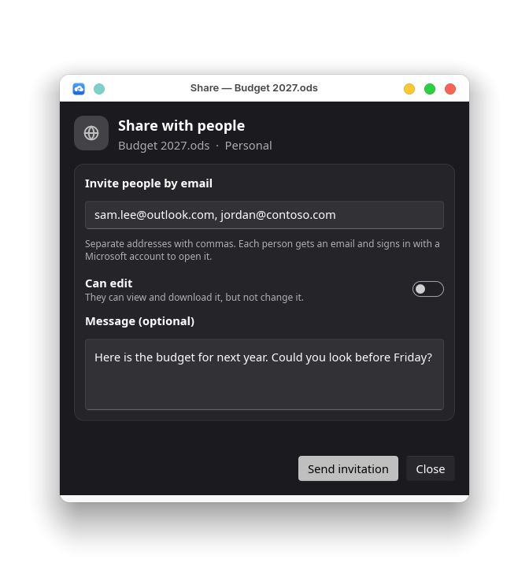

# A GUI that works with OneDrive on Linux (unofficial)

**Entirely unofficial — not endorsed by Microsoft at all.**

## Why this app

- **The easiest way to get OneDrive on Linux.** Download one file for your system (.deb, .rpm or
  AppImage) and open it. If the OneDrive client isn't installed yet, the app installs it for you on
  most distributions. You never need a terminal or a configuration file: sign in with your browser,
  tick your folders, done. Basically, I wanted my mom to be able to setup Onedrive on Linux and be able to use it without needing my help. 
I also wanted it to be light and fast without the need for installing additional python libraries, hence the choice to use Rust.
- **Quick and light.** It's a small native program written in Rust, with no Python, Java or built-in
  web browser to load. The tray icon uses about 10 MB of memory, the panel opens in about half a
  second, and the settings window closes completely when you're done with it.
- **Syncing that keeps going.** Each account syncs as a background service, so your files stay in sync
  with the app closed, after a restart, and even if you never open the app again.
- **Careful with your files.** Big changes are shown as a dry run first, syncing stops instead of
  deleting a large number of files online, and nothing in the app runs a program you didn't ask for.

**Sync OneDrive and SharePoint on Linux without the command line.** A settings window and tray icon for
the excellent [OneDrive Client for Linux](https://github.com/abraunegg/onedrive) by abraunegg, which does
the actual syncing. Install this app (it sets up the client for you), sign in, pick your folders, done. The goal was to build a
full featured GUI based program which any person can install and use without needing the CLI at all or deep knowledge of Linux.


I make ZERO, NONE, ABSOLUTELY NO SUGGESTION OR GUARANTEE this code is safe, does what it says, or won't harm
your PC in some way. You are welcome and encouraged to review the source code 
prior to installing. Again, to be clear, this app is not endorsed by Microsoft
and I'm not affiliated with Microsoft in any way. Since it's a Rust GUI for the existing OneDrive
sync client, syncing issues should go to the original app, which is linked above.


<table>
  <tr>
    <td></td>
    <td></td>
  </tr>
  <tr>
    <td></td>
    <td></td>
  </tr>
  <tr>
    <td></td>
    <td></td>
  </tr>
</table>

## New in 0.4.0

The biggest update yet. Everything below is new since 0.3.5:

- **A tray panel like the one on Windows.** Click the icon for every account's status, the files
  syncing right now with their progress, and recent files with their icons. Click one to open it.
- **Back up this computer's folders** (Desktop, Documents, Pictures, Music, Videos) into OneDrive.
- **Version history** from Dolphin: see a file's earlier versions, open one, or restore it.
- **Share with people** from Dolphin: invite people by email to view or edit, with a message.
- **Editing links** as well as view-only links, from Dolphin's right-click menu.
- **Files changed in two places** are listed, and you choose which version to keep, or both.
- **Says which files didn't sync, and why**, in plain words, with what to do about them.
- **Protection against big deletions**: syncing stops and asks before deleting lots of files online.
- **Choose the direction**: both ways, download only or upload only.
- **Skip what you don't want synced**: hidden files, names, symbolic links, `.nosync` folders, and
  shared folders for work and school accounts.
- **Every client setting, in plain words**, in a new *Advanced* section, with *Show all settings in use*.
- **Government and national clouds** (US GCC High and DoD, Germany, China).
- **Storage warnings** when an account is almost full, and when it's full.
- **Pauses on a metered connection or in power saver**, and carries on by itself afterwards.
- **Quick links** to the OneDrive website, its recycle bin and *Restore your OneDrive*.
- **Stop syncing on Quit**, if you'd like the tray's *Quit* to stop everything.
- **Tells you when a new version is out** (once a day; you can switch it off).
- **A new look**: a new icon, and tray icons that show a green check when everything is synced.
- **Even more careful with your files**: nothing is ever overwritten while moving or backing up
  folders, two sync engines never run on one account, and settings files that can't be read are never
  replaced.

## What it does

It covers what the OneDrive app on Windows does, and then some. In short:

| | |
|---|---|
| **Accounts** | Personal, work or school, SharePoint libraries, government and national clouds, as many as you like |
| **What syncs** | Pick folders, skip by name or type, both ways or one way, schedules, speed limits |
| **Safety** | Dry runs before big changes, big-delete protection, conflicts you settle, nothing overwritten |
| **Everyday use** | Tray panel, notifications, storage warnings, pauses on metered networks and power saver |
| **Windows features** | Folder backup, version history, sharing links and invitations, recycle bin and *Restore your OneDrive* |
| **Control** | Every client setting in plain words, move the OneDrive folder, works alongside the command line |

### Accounts and signing in

- **Personal, work/school and SharePoint.** Add as many accounts and document libraries as you like. For
  SharePoint, paste the site or library address from your browser, or pick from the sites your work
  account belongs to (only sites that account can already open ever appear).
- **Government and national clouds** (US GCC High and DoD, Germany, China) can be chosen when adding
  an account.
- **Signing in and out.** Your browser opens, you log in, and the app picks it up by itself. If Microsoft
  stops accepting a saved sign-in (after a password change, say), the app says so and lets you sign in again.
- **Plays well with an existing setup.** Accounts you already set up for the OneDrive client (including
  `onedrive*.service` units, and config folders kept in a dotfiles manager) show up automatically, and
  everything the app sets up keeps working from the command line.

### Choosing what syncs, and when

- **Choosing folders.** Browse everything in your OneDrive, including folders that aren't on this computer
  yet, and tick the ones you want. Rules you've written into `sync_list` yourself are kept.
- **Choose the direction.** Sync both ways, download only (keep this computer a copy of what's online),
  or upload only (back this computer up to OneDrive).
- **Skip what you don't want synced:** hidden files, files and folders by name, symbolic links, and
  folders holding a `.nosync` file. Work and school accounts can also sync shared folders you've added
  to *My files*.
- **Sync schedules** (for example only overnight, 23:00 to 07:00) and a **speed limit**.
- **Pauses on a metered connection and in power saver** (both can be switched off), then carries on by
  itself. *Sync now* always gets past a pause for an hour.
- **Your choice of when it syncs.** Syncing normally runs all the time; in *App settings* you can make
  *Quit* in the tray icon's menu stop it too, until the app next starts.

### Careful with your files

- **Safe changes.** Anything that makes the client rebuild its view (a "full resync") first runs a dry run
  showing exactly what would be downloaded, uploaded or deleted. Nothing changes until you press Apply,
  and you can switch full resyncs off per account. If the app is closed mid-preview, your settings are
  put back the next time it starts.
- **Protection against big deletions.** If a lot of files are deleted on this computer at once, syncing
  stops before deleting them online too, and asks: delete them online as well, or download them again?
  Either way you see a dry run first. (Put them back from the Trash and press *Sync now* if it was a
  mistake.) You choose how many deleted items count as "a lot".
- **Files changed in two places** are listed with *Compare*, and you choose: keep this computer's
  version, OneDrive's (the other copy goes to the Trash, never deleted outright), or both.
- **Says which files didn't sync, and why.** A file open for editing in SharePoint or Office, one shared
  with you as read-only, and the like are named in plain words, with what to do about them.
- **Never overwrites.** Moving folders, backing them up and settling conflicts never replace a file that
  is already there, even one that appears while the app is working. Copies to another drive are only
  put in place once they're complete.
- **One thing at a time.** While the app is changing an account (signing in, a preview, moving its
  folder, a backup), nothing else can start syncing it, so two sync engines never touch one account.
- **Won't sync the wrong folder.** Your home folder, system folders, the app's own settings and other
  accounts' folders are refused, even when reached through a link or on an unplugged drive.
- **Settings are never lost.** A settings file that can't be read is never written over, and a damaged
  one is kept aside before the app starts fresh.

### Tray icon and notifications

- **Tray icon and panel.** Click the icon for a panel like the one on Windows: every account's status,
  the files syncing right now with their progress, and recent files with their icons, each in its own
  scrolling list. Click a file to open it, or show it in its folder. Right-click for a short menu:
  *Sync now*, *Pause for 1 hour / 4 hours / until tomorrow*, *Open folder* and *Settings*.
- **Notifications** when something needs your attention: an error, a resync, signing in again.
- **Storage warnings** when an account is almost full, and again when it's full.
- **Activity view** of what was uploaded, downloaded or deleted, with *Show in folder*.

### The extras from Windows

- **Back up this computer's folders.** Keep Desktop, Documents, Pictures, Music and Videos in OneDrive,
  as on Windows. They stay where your apps expect them, and nothing is ever deleted: stopping leaves
  the files in OneDrive.
- **Version history and sharing from Dolphin.** Right-click a file to see its earlier versions, open
  one or restore it, or invite people by email to view or edit it.
- **Sharing links from Dolphin**: *Copy view-only link*, *Copy editing link* and *View on the OneDrive
  website*. For a personal account, anyone with the link can use it; for a work or school account, only
  people in your organization can, never a public link. The notification says plainly what the link
  allows.
- **Quick links** to the OneDrive website, its recycle bin and *Restore your OneDrive*.

### Settings and control

- **Every client setting, in plain words.** An *Advanced* section covers the rest of the client's
  options: transfer threads and order, timeouts, HTTP/1.1, file size limits, permissions, local-first
  syncing, webhooks, log files and more. Each one is checked before it's saved, the ones that can lose
  data are marked, and *Show all settings in use* shows exactly what the client is running with.
- **Move the OneDrive folder** to another place or drive, without downloading everything again.
- **Fits your desktop**: light and dark mode, your file manager and your browser.
- **Updates itself in place.** After you install a new version, the tray and an open window switch to it
  on their own. Once a day it looks for a new version and tells you when one is out (you can switch
  that off).
- **Light on your computer.** It's written in Rust, a language that compiles to a small, fast native
  program: no built-in web browser engine, and no Python or Java needed. The download is 10–14 MB.

### How much memory and CPU it uses

Measured on a desktop PC with three accounts syncing:

| Part | When it runs | Memory | CPU |
|---|---|---|---|
| Tray icon | All the time | About 10 MB | Practically none: about 1 second of CPU time per 40 minutes |
| Panel (a click on the icon) | Only while it's open; it fully exits when it closes | About 45 MB | A little while open, to keep the lists up to date |
| Log reader, one per account | While the tray runs | 4–5 MB each | Practically none |
| Settings window | Only while it's open; it fully exits when you close it | About 60 MB (up to 140 MB counting graphics libraries shared with other programs) | Near zero once it's drawn |
| AppImage helper (AppImage only, not the .deb or .rpm) | While the app runs | About 16 MB | None |

The OneDrive client, the separate program that does the actual syncing, uses more: from about 15 MB to
several hundred MB per account, depending on how many files that account has.

## Install

### 1. The OneDrive Client for Linux, version 2.5 or newer

This is the free program that does the actual syncing; this app is the window and tray icon for it.
It's a separate program, so it gets its own updates. You usually don't need to do anything: if it's
missing or too old, the app says so and its **Install it for me** button installs it after asking
for your password. If you'd rather install it yourself, choose
*I'll install it myself*. The app notices the client within a few seconds of it being installed,
wherever it came from.

| Your system | What *Install it for me* does |
|---|---|
| Fedora | `dnf install onedrive` (the app's .rpm already pulls it in) |
| openSUSE Tumbleweed, Leap 16 | `zypper install onedrive` (Leap 15 only has an old client, so there the app shows the instructions instead) |
| Ubuntu 22.04+, Linux Mint, Debian 11+, Pop!_OS, Zorin, Raspberry Pi OS | These come with an old version of the client that its author no longer supports. So the app adds the place the author recommends getting it from to your computer's list of software sources (like adding a trusted app store), then installs the current version from there. Your normal software updates keep it up to date after that. This is the same setup as the client's [Ubuntu / Debian installation guide](https://github.com/abraunegg/onedrive/blob/master/docs/ubuntu-package-install.md). |
| Arch, Manjaro, EndeavourOS, CachyOS | Arch doesn't include the client, but the AUR (install recipes shared by Arch users) does. The app builds it from there, which takes a few minutes. Normal software updates don't cover the AUR, so the app tells you when a newer client is out and updates it for you. |
| Fedora Silverblue/Kinoite, SteamOS, anything else | No button; the app links to the client's [installation instructions](https://github.com/abraunegg/onedrive/blob/master/docs/install.md) |

### 2. This app

Download it from the [latest release](https://github.com/sweatshopking/A-GUI-that-works-with-OneDrive-on-Linux-unofficial/releases/latest):

| Your system | File | How to install |
|---|---|---|
| Ubuntu 22.04+, Linux Mint 21+, Debian 12+, Pop!_OS, Zorin | `linux-onedrive-gui_…_amd64.deb` | Double-click it, or `sudo apt install ./linux-onedrive-gui_*.deb` |
| Fedora 41+, openSUSE | `linux-onedrive-gui-….x86_64.rpm` | Double-click it, or `sudo dnf install ./linux-onedrive-gui-*.rpm` (openSUSE: `sudo zypper install ./linux-onedrive-gui-*.rpm`) |
| Anything else, or no admin rights | `A_GUI_that_works_with_OneDrive_on_Linux-unofficial-…-x86_64.AppImage` | Right-click → Properties → allow executing, then double-click it. In the app, *App settings → Add to my applications menu*. |

Those are for ordinary PCs. For ARM computers (Raspberry Pi 4/5, ARM laptops) pick the same kind of file
ending in `arm64` / `aarch64`.

Then open **A GUI that works with OneDrive on Linux (unofficial)** from your applications menu and follow
the steps. To update, install the newer file the same way.

### Requirements

- 64-bit Linux with systemd (almost every desktop distribution)
- The OneDrive Client for Linux 2.5 or newer (step 1)
- For the tray icon, a system tray: built into KDE Plasma, Cinnamon, XFCE, MATE and Budgie. On GNOME, add
  the *AppIndicator and KStatusNotifierItem Support* extension (Ubuntu has it already). Without one,
  syncing, schedules and pauses still work; you just don't see the icon.

## Uninstalling

Use **App settings → Uninstall…**. It asks what should happen to your OneDrive setup:

- **Keep my OneDrive setup** — only the app goes. Your accounts keep syncing in the background with the
  OneDrive Client for Linux, and you can keep using it from the command line.
- **Remove everything** — also stops all background syncing, signs out and deletes every OneDrive sync
  configuration on this computer.

Your synced files stay on the computer either way. Then it removes the app itself (for a .deb or .rpm it
asks for your password). Uninstalling with your package manager instead is the same as *Keep my OneDrive
setup*.

## Where to report problems

- Problems with **syncing itself** (files not syncing, errors from the client): the
  [OneDrive Client for Linux](https://github.com/abraunegg/onedrive/issues).
- Problems with **this app** (a button that doesn't work, something confusing, ideas):
  [this project's issues](https://github.com/sweatshopking/A-GUI-that-works-with-OneDrive-on-Linux-unofficial/issues).

## How it works

Each account is a configuration folder for the OneDrive client (`~/.config/onedrive`,
`~/.config/onedrive-work`, …) and a systemd user service that runs `onedrive --monitor` for it, so it keeps
syncing in the background, after a restart, and when the app is closed. The app only writes the client's
normal configuration files.

- Status and activity come from each service's log; controls go through `systemctl --user`.
- Browsing online folders, finding SharePoint libraries, storage use and sharing links use Microsoft Graph
  with the client's saved sign-in, which the app only reads.
- The app's own settings (names, schedules, pauses) live in `~/.config/linux-onedrive-gui/settings.json`.
- Every week, an automated check makes sure the newest client release still has everything this app
  relies on ([`packaging/check-client-compat.sh`](packaging/check-client-compat.sh)), and opens an issue if not.

## Building from source

You need Rust (via [rustup](https://rustup.rs)) and the development packages for fontconfig, freetype,
xkbcommon and wayland. Then:

```sh
cargo build --release
./target/release/linux-onedrive-gui
```

To build the release packages the way the GitHub workflow does (needs podman or docker):

```sh
packaging/build-in-containers.sh   # .deb + AppImage on Ubuntu 22.04, .rpm on Fedora 41
```

Tests: `cargo test`. The window can also be driven by a script for end-to-end tests (see
`src/testdrive.rs`, built with `--features test-driver`), and `packaging/smoke-test.sh` installs a built
package on a fresh system and checks that it opens.

## License and credits

GPL-3.0-or-later; see [LICENSE](LICENSE).

- Syncing is done by the [OneDrive Client for Linux](https://github.com/abraunegg/onedrive) by abraunegg
  (GPL-3.0), which you install separately; this app runs it. See
  [packaging/THIRD-PARTY.md](packaging/THIRD-PARTY.md).
- The interface uses [Slint](https://slint.dev) (under its GPL-3.0 license) and
  [ksni](https://github.com/iovxw/ksni) for the tray icon.

This project is not made by or affiliated with Microsoft. OneDrive and SharePoint are trademarks of Microsoft.
